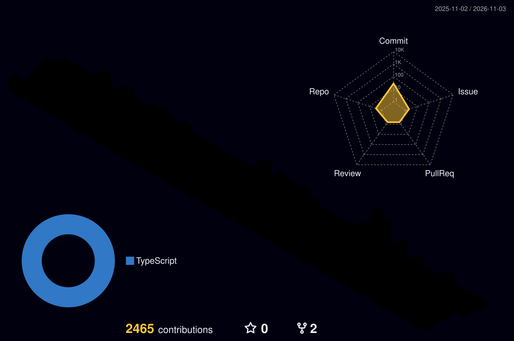

  
  

  
  
  

---

## 👨‍💻 Sobre mim

Desenvolvo, integro e sustento aplicações web e ecossistemas de software **ponta a ponta**: da interface ao servidor, passando por APIs, webhooks, automações e agentes de IA, até a infraestrutura que mantém tudo no ar.

|  |  |
|---|---|
| 🤖 **IA aplicada** | Agentes autônomos, engenharia de prompts e automações para atendimento, operação e produto |
| 🔌 **Integrações** | APIs REST, webhooks e fluxos n8n conectando plataformas de terceiros |
| 🏗️ **Arquitetura** | Desenho de soluções, documentação técnica (C4, UML, MDL) e decisões registradas |
| ⚙️ **DevOps** | Linux, Docker, VMs/VPS, GitHub Actions e monitoramento de serviços em produção |
| 📊 **Dados** | PostgreSQL, ETL em Python, Grafana, Power BI e Qlik Sense |
| 🧠 **Explorando agora** | Memória durável para agentes de código, com vault Obsidian |

> 🔒 Boa parte do que construo (Digi2B, AI Connect e outros clientes) vive em repositórios privados. Por isso o gráfico público mostra só uma fração do trabalho.

---

## 🧰 Stack

| | |
|:--|:--|
| **Front-end** |  |
| **Back-end** |  |
| **Dados** |  |
| **Infra e qualidade** |  |

---

## 🚀 Projetos em destaque

---

## 📈 GitHub em números

---

## 🌐 Contribuições

<picture>
  <source media="(prefers-color-scheme: dark)" srcset="https://raw.githubusercontent.com/bcocheto/bcocheto/output/github-snake-dark.svg" />
  <source media="(prefers-color-scheme: light)" srcset="https://raw.githubusercontent.com/bcocheto/bcocheto/output/github-snake.svg" />
  
</picture>

